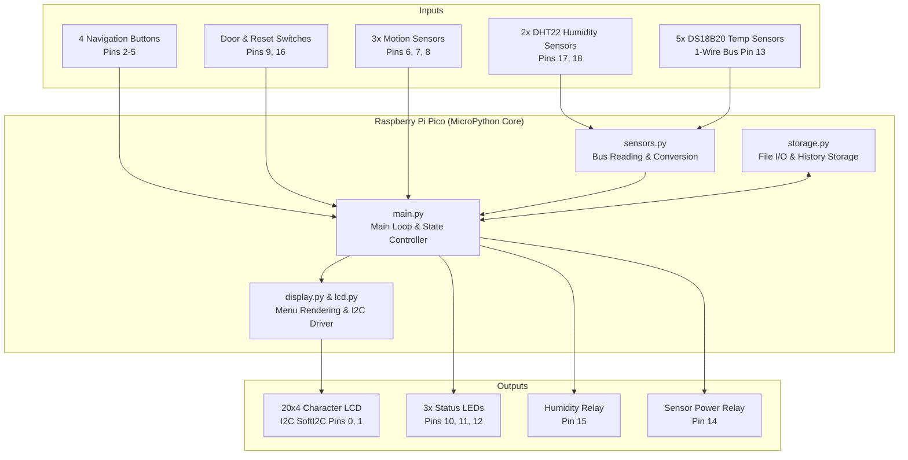
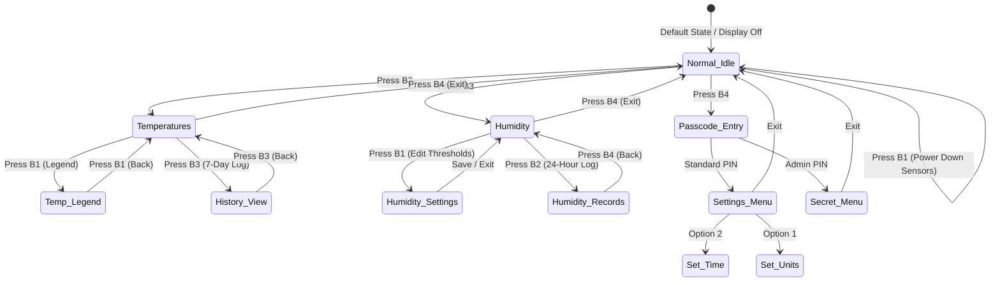

# Environmental Monitoring & Room Automation System

An embedded control system built on the Raspberry Pi Pico (MicroPython). It provides multi-zone temperature tracking, automated humidity regulation with hysteresis, motion-triggered alerts, and an interactive LCD menu with password-protected configuration.

---

## Project Overview

This project was built to monitor and automate an indoor environment using low-cost microcontrollers and digital sensors. It tracks multi-point environmental data in real time, manages physical hardware relays (power outlets and sensor lines), logs daily records to onboard flash storage, and presents a multi-level menu via an I2C character LCD.

### Key Features

* **Multi-Zone Temperature Monitoring:** Polls 5 Dallas DS18B20 1-Wire sensors (Front, Back, Hallway, Room, Light zone) mapped by hardware ROM address, tracking current, daily high, and daily low temperatures.
* **Dual DHT22 Humidity Control & Hysteresis:** Reads two independent DHT22 temperature/humidity sensors and controls an AC plug relay, turning a humidifier on/off. Features automatic 2% hysteresis logic (`turn off at target%`, `turn on at target - 2%`) to prevent rapid relay cycling.
* **Rolling 7-Day History:** Automatically archives daily high/low temperatures at midnight to non-volatile flash storage (`history.txt`), keeping a rolling 7-day log accessible through the LCD.
* **Security & Access Control:** 4-button PIN interface guarding both user settings (unit toggle, real-time clock setting) and privileged hardware controls (sensor power relays, system re-arming).
* **Motion Alert & Door Arming System:** Monitors 3 motion zones with visual LED indicators. Uses a cabinet door push-switch to monitor entry and includes timed re-arming presets.
* **Fault-Tolerant Design:** Includes sensor fallbacks (DHT22 duplication if one drops offline), file corruption recovery for credentials, screen-saver timeouts, and an unhandled exception logging loop.

---

## System Architecture

The following diagram shows how the sensors, control buttons, display, and actuators connect to the main program loop:



---

## Menu Navigation & State Flow

The UI uses a 4-button control scheme (B1–B4) that changes functionality depending on the active screen:



---

## Hardware Components & Pinout

| Peripheral | Component | Pin / Bus | Description |
| :--- | :--- | :--- | :--- |
| **Microcontroller** | Raspberry Pi Pico | — | MicroPython runtime |
| **Display** | 20x4 LCD (HD44780) | GP0 (SDA), GP1 (SCL) | PCF8574 I2C Backpack @ 100 kHz |
| **Navigation** | 4x Push Buttons | GP2, GP3, GP4, GP5 | Internal `PULL_UP`, active-low |
| **Motion Sensors** | 3x PIR / Digital Sensors | GP6, GP7, GP8 | Bottom, Middle, Top zones |
| **Door Monitors** | 2x Reed / Momentary | GP9, GP16 | Door state & timed reset button |
| **Indicators** | Red, Blue, Yellow LEDs | GP10, GP12, GP11 | Motion alerts & system state |
| **Temperature** | 5x DS18B20 (1-Wire) | GP13 | Single-wire bus with pull-up |
| **Power Relay** | Transistor / Relay module | GP14 | Controls external sensor rail |
| **Appliance Relay** | Isolated Relay Module | GP15 | Controls humidifier/dehumidifier plug |
| **Humidity Sensors**| 2x DHT22 / AM2302 | GP17, GP18 | Independent digital inputs |

---

## Project Structure

```text
├── main.py                         # Application entry, loop scheduler, and button routing
├── display.py                      # UI layouts and text positioning for LCD
├── lcd.py                          # Low-level 4-bit nibble driver over I2C
├── sensors.py                      # Hardware communication (1-Wire & DHT22 reading)
├── storage.py                      # Flash memory persistence for history and passwords
├── temperature_sensor_IDs.txt      # ROM hex addresses of DS18B20 sensors in display order
└── README.md                       # Project documentation
```

### Module Responsibilities

* **`main.py`**: Runs the non-blocking execution loop. Handles debounced button reading, timed backlight shutoff, state transitions, motion triggers, and schedule resets.
* **`lcd.py`**: A lightweight display driver written directly for MicroPython's SoftI2C. It splits text and commands into 4-bit chunks to control the screen without needing external libraries.
* **`sensors.py`**: Isolates raw hardware calls. Converts DS18B20 addresses into organized zones, handles unit conversions ($C \leftrightarrow F$), and gracefully falls back to single-sensor reading if one DHT22 fails.
* **`storage.py`**: Handles basic file reading and defensive error handling (creates default files with fallback credentials if missing or corrupted).

---

## Key Engineering Decisions

1. **Non-Blocking Loop Timing:** Instead of using long `time.sleep()` calls that make user buttons unresponsive, time-based actions (such as LCD timeouts, scheduled readings, and reset intervals) use `time.ticks_ms()` and `time.ticks_diff()`.
2. **Hysteresis Logic for Relay Control:** To prevent relay chatter (rapid toggling on/off when the humidity level hovers right at the threshold), the code applies a 2% deadband before switching the relay state back.
3. **Custom I2C Display Driver:** Rather than relying on heavy third-party drivers, `lcd.py` directly coordinates 4-bit commands over I2C, keeping memory footprint low and removing external library dependencies.
4. **Sensor Address Mapping:** DS18B20 1-Wire sensors share a single data line. Storing specific sensor ROM IDs in `temperature_sensor_IDs.txt` ensures physical locations remain mapped to the correct LCD position regardless of bus discovery order.

---

## Setup & Installation

1. Flash the Raspberry Pi Pico with the latest stable version of MicroPython.
2. Wire the sensors, relays, and buttons according to the Hardware Pinout.
3. Connect the Pico to your computer using a USB cable and open Thonny (or your preferred IDE).
4. Upload the .py files to the root directory of the Pico.
5. The system will automatically detect connected 1-Wire sensors on boot and begin running main.py.

---

## Hardware Build & Photos

*(Place real photos of your breadboard/wiring, enclosure, and LCD screens here)*

| Enclosure / Wiring | LCD Main Screen |
| :---: | :---: |
|  |  |
